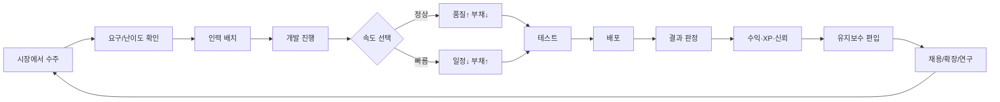

# 03. 게임 루프

## 1. 루프 계층

카이로소프트식 구조를 **3층**으로 나눈다.

```
[마이크로 루프]  배치·선택·확인          (수 초)
[코어 루프]      수주→개발→정산→성장      (3~8분)
[메타 루프]      확장·연구·랭킹·엔딩      (수십 분~수 시간)
```

---

## 2. 코어 루프 (플레이어가 반복하는 것)



### 단계별 플레이어 행동

| 단계 | 플레이어가 하는 일 | 자동으로 도는 일 |
|------|-------------------|------------------|
| 수주 | 의뢰 카드 비교 후 수락 | 시장 리프레시 |
| 확인 | 필요 스택/예산/기간 확인 | — |
| 배치 | 직원 드래그/탭 할당 | 스탯 매칭 점수 계산 |
| 개발 | 속도(정상/빠름/야근) 토글 | 진행도·버그·부채 틱 |
| 테스트 | QA 투입 or 스킵 | 버그 발견량 |
| 배포 | 배포 버튼 / 일정 자동 | 장애 롤 |
| 정산 | 결과 팝업 확인 | 돈·XP·신뢰 반영 |
| 확장 | 채용·책상·연구 구매 | 주간 고정비 |

---

## 3. 시간 모델 (초안)

| 단위 | 의미 | 용도 |
|------|------|------|
| **틱** | 최소 시뮬레이션 단위 | 진행도, 버그, 스트레스 |
| **일** | 틱 N개 = 1일 (예: 8틱 = 업무일) | 급여는 주 정산, 이벤트는 일 |
| **주** | 7일 | 고정비, 시장 리프레시, 랭킹 |
| **월** | 4주 | 세금/임대 정산, 단계 체크 |

**권장 MVP**: `1일 = 8틱`, 기본 배속 1틱/0.6초 → 하루 ≈ 5초.  
2x 시 템포 활발, 일시정지로 배치 여유.

### 시간대 이벤트 가중치
- 금요일 오후 틱: “금요일 배포” 이벤트 가중치 ↑
- 월요일 오전: 회의 이벤트 ↑
- 배포 직후 24시간: 장애 이벤트 ↑

---

## 4. 프로젝트 상태 머신

```
OpenMarket → Contracted → InDev → InTest → Deploying → Done
                              ↓         ↓         ↓
                           OnHold ←—— Incidents ——→
                              ↓
                         Maintenance (레거시 슬롯)
```

| 상태 | 설명 |
|------|------|
| Contracted | 수락됨, 인력 미배치 가능 |
| InDev | 진행도 증가, 부채/버그 누적 |
| InTest | 진행 느림, 버그 감소 가능 |
| Deploying | 짧은 구간, 장애 판정 |
| Done | 완료 정산 후 Maintenance로 |
| Maintenance | 주당 공수 소모, 방치 시 부채↑ |
| OnHold | 인력 0 또는 이벤트 중단 |
| Failed | 실패 정산, 신뢰↓, 일부 부채 잔존 |

---

## 5. 마이크로 루프 (한 화면에서의 손맛)

1. 알림: “새 의뢰 3건” / “부채 이자 경고”
2. 탭 → 카드 확인 → 수락
3. 직원 패널에서 프로젝트로 할당
4. 속도 토글 (정상/스피드/야근)
5. 다른 프로젝트/시설로 시선 이동
6. 팝업(이벤트) 처리
7. 완료 팡페어 → 상점/채용으로 돈 사용

**중요**: 모바일에서는 드래그보다 **탭-탭 할당**을 기본으로 한다.

---

## 6. 메타 루프

| 주기 | 콘텐츠 |
|------|--------|
| 매일 | 이벤트 0~2, 진행 확인 |
| 매주 | 급여·임대·서버비, 시장 갱신, 부채 이자 적용 |
| 매 단계 | 사무실 비주얼 업, 슬롯/연구 해금 |
| 위기 | 부채 임계 → 강제 리팩토링 주간 |
| 클라이맥스 | 대형 프로젝트(이름 있는 고객) 수주 |

---

## 7. 랜덤 이벤트 루프

```
매 일 종료 시:
  roll = random()
  if roll < dailyEventChance:
    pick from weighted pool (현재 상태 태그 필터)
    show modal (선택 1~2)
    apply immediate + delayed effects
```

### 이벤트 카테고리
| 태그 | 예시 | 주 효과 |
|------|------|---------|
| `deadline` | 금요일 배포 | 신뢰↔부채 |
| `incident` | 서버 다운 | 자금·신뢰·야근 |
| `people` | 핵심 개발자 퇴사 위기 | 버스팩터 |
| `scope` | 요구사항 변경 | 기간↑ 또는 부채↑ |
| `trend` | 신규 프레임워크 | 연구/학습 압박 |
| `culture` | 회의 폭증 | 진행↓ 스트레스↑ |

상세 수치: `08_밸런스.md`

---

## 8. “막힘” 방지 설계

| 문제 | 해결 |
|------|------|
| 의뢰가 없음 | 매주 최소 2개 보장, 난이도 스케일 |
| 돈이 없음 | 소액 긴급 외주(부채↑), 플레이어 야근 |
| 사람이 없음 | 임시 계약직(고비용·저성장) |
| 부채로 진행 불가 | 리팩토링 미니 프로젝트 강제 제안(보상형) |

---

## 9. 튜토리얼 루프 (라이트)

스토리 모드 없이 **가드 레일**만:

1. 첫 실행: 강제 의뢰 1개 + 플레이어만 배치
2. 첫 완료 후: “책상 구매” 하이라이트
3. 첫 직원: 배치 유도
4. 첫 스피드 개발: 부채 아이콘 설명
5. 첫 이자 발생: 리팩토링 버튼 소개

스킵 가능. 재등장 없음(헬프 패널로 대체).
